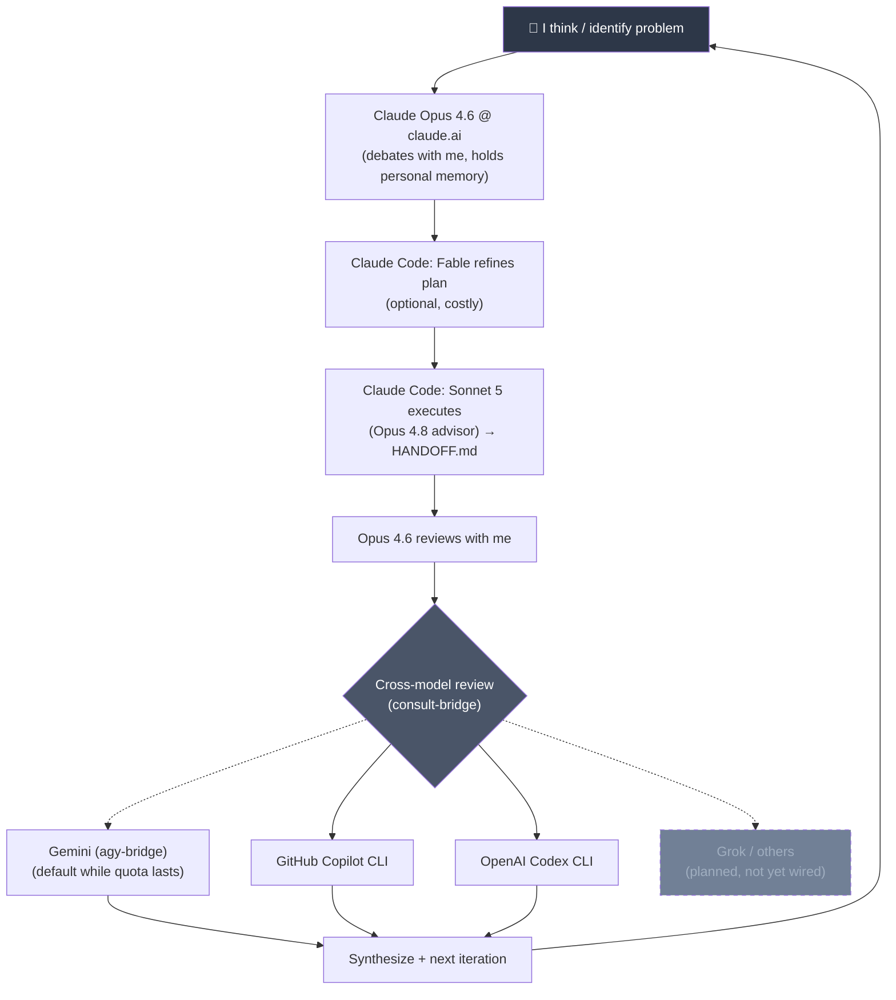

**English** · [繁體中文](README.zh-TW.md)

# claude-bridges

MCP servers that let Claude Code delegate to other coding CLIs — cross-model second opinions, structured reviews, and a multi-engine consultation panel.

Most people use AI to autocomplete or to ask one model one question. I use multiple models as a structured thinking system with checks and balances: debate, execute, review, cross-check, iterate.

## At a glance

| | |
|---|---|
| Problem | One model gives one answer, with one set of blind spots. |
| What I built | MCP servers that let Claude Code send the same prompt to other coding CLIs and hosted APIs — in parallel (`mode: all`) or as a fallback chain (`mode: first`). |
| Result | Free OpenRouter models answered a small code-review prompt in 2-21 s on 2026-10-27. The NIM chain was picked from an eval the same day: ultra answered in 27-79 s, minimax-m3.1-flash in 93 s, super-vl in 57 s, all finding the planted bugs. |
| Stack | Node.js; `@modelcontextprotocol/sdk` and `zod`. |
| Status | Active. `agy` is in the default order while it drains its remaining quota (since 2026-10-27) and is removed once exhausted. |

## How it works



This isn't "ask ChatGPT." Each model has a role, a sandbox, and a review gate.

The panel is the engines in `CONSULT_ORDER` (default `copilot,codex,deepseek,agy,nim,openrouter,opencode,azure,gemini`). In `mode: all` (the default) one prompt goes to all of them in parallel and every successful answer comes back labelled by engine. In `mode: first` they run as a sequential fallback chain and the first success wins. A failed engine fails over to the next, and the trail is appended to the result.

`deepseek`, `nim`, `openrouter` and `dsapi` get no cwd, shell or file access — they only ever see the prompt text, so their prompts must be self-contained.

The full engine table, each fallback chain, and the per-engine timeouts are in [docs/engines.md](docs/engines.md).

## The engineering story

A single answer hides its own blind spots. The panel exists so that no single model's output ships unchecked.

A 2026-10-27 eval used a code-review prompt with planted bugs to pick the NIM chain. Ultra answered in 27-79 s, minimax-m3.1-flash in 93 s and super-vl in 57 s, and all three found the bugs. glm-5.3 (396 s), glm-5.3-flash (319 s) and step-5-preview (228 s) were too slow or too erratic for the first steps; `openai/gpt-oss-20b` answered in 5-10 s and closes the chain. The same day, the OpenRouter free models answered a small code-review prompt in 2-21 s.

The cause of that spread is the free tier itself: models stall, vanish (HTTP 404, or 410 after end of life) or return reasoning only, and latency varies a lot run to run because the free queue is shared.

The fix is a fallback chain per free-tier engine, with a per-attempt timeout and a rule that a bare `nim` or `openrouter` may land on a different model. A test enforces that the OpenRouter and NIM chains share no model family, so the panel never counts one voice twice. A quota limit that names its own reset time becomes a lock, so the next run skips that engine until then.

What stays open: Grok and others are in the loop diagram but have no bridge yet, and `agy` leaves the default order once its Google AI Plus quota is used up.

The wider division of labour is in [docs/why.md](docs/why.md): Opus 4.6 holds the plan and the memory, Sonnet 5 writes the code with Opus 4.8 as advisor, and `consult` cross-checks before anything lands. Each delegation also carries a role prompt.

## Build / run

```bash
npm install
node consult-cli.js --mode all --order copilot,codex "prompt"
npm test
```

One `npm install` at the root serves all servers — Node resolves `node_modules` by walking up from each `index.js`.

- MCP registration, the CLI logins, and the `"timeout": 660000` that `nim` needs: [docs/setup.md](docs/setup.md).
- All flags, round 2, quota locks and debate mode: [docs/consult-cli.md](docs/consult-cli.md).
- Environment variables and their defaults: [docs/configuration.md](docs/configuration.md).
- `consult-cli.js --json` prints one `{ok,code,message,data}` object; the contract is in [docs/cli-json.md](docs/cli-json.md).

## Repo layout

```
claude-bridges/
  package.json            shared deps (@modelcontextprotocol/sdk, zod)
  node_modules/           one install serves all bridges
  lib/
    common.js             shared MCP boilerplate, CLI runner, cross-platform exe resolution
    engines.js            engine runners shared by consult-bridge and consult-cli
    args.js               consult-cli argument parsing
    updates.js            throttled update check + --update
  consult-cli.js          same panel as a plain command (no MCP schema cost)
  test/                   node --test suite (npm test)
  copilot-bridge/
    index.js              standalone MCP server → copilot_exec tool
  codex-bridge/
    index.js              standalone MCP server → codex_exec tool
  consult-bridge/
    index.js              aggregator MCP server → consult tool
  agy-bridge-vendored/    vendored copy of the agy-bridge (Gemini)
```

There are three MCP servers. `consult-bridge` is the one in active use; `copilot-bridge` and `codex-bridge` are **legacy** (kept working, not registered by default). Tool names, default postures and binary resolution are in [docs/bridges.md](docs/bridges.md).

## Limits and open items

- Grok and others are in the aspirational loop but do not have bridges yet.
- `agy` is in the default order only while its Google AI Plus quota lasts (since 2026-10-27).
- `opencode` free models may be logged or used by the provider: send non-private prompts only.
- NIM free-trial use is subject to the NVIDIA API Trial Terms (evaluation, non-production use), and the budget is per key, so any other application using the same key shares it.
- NIM's `/v1/models` also lists models the key cannot call, and a model stuck in the free-tier queue still fails at about 300 s.
- The dsapi 300 requests/day warning is a soft alarm only: nothing is blocked.

## License

MIT License. See [LICENSE](LICENSE).
