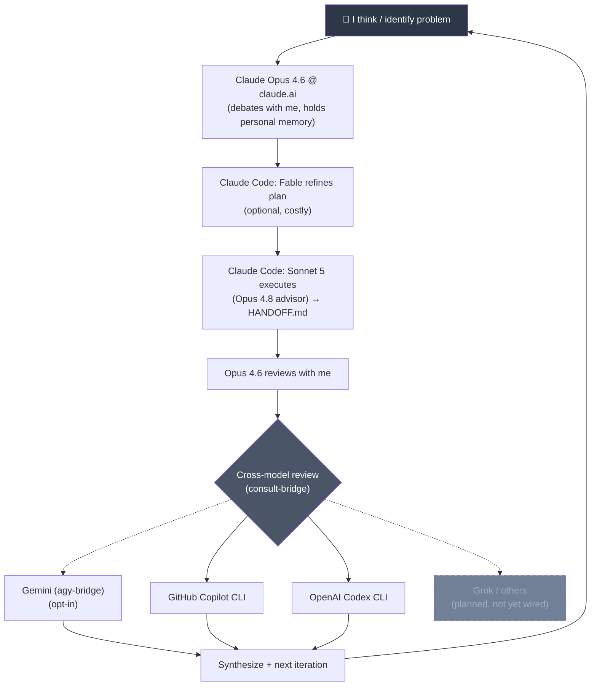

**English** · [繁體中文](README.zh-TW.md)

# claude-bridges

MCP servers that let Claude Code delegate to other coding CLIs — cross-model second opinions, structured reviews, and a multi-engine consultation panel.

Most people use AI to autocomplete or to ask one model one question. I use multiple models as a structured thinking system with checks and balances: debate, execute, review, cross-check, iterate.

## The Thinking Loop



This isn't "ask ChatGPT." Each model has a role, a sandbox, and a review gate. No single model's output ships unchecked.

## What's Actually Wired

The `consult` tool currently fans out to **five engines**:

| Engine | Wraps | Tier |
|---|---|---|
| `copilot` | GitHub Copilot CLI (`copilot -p`) | Free (GitHub) |
| `codex` | OpenAI Codex CLI (`codex exec`) | Free (ChatGPT) |
| `agy` | Antigravity / Gemini CLI | Google AI Plus (low quota); **opt-in (not in default order)** |
| `deepseek` | `deeperseeker` proxy over a DeepSeek web account (HTTP, not a CLI) | Free (throwaway account) |
| `nim` | NVIDIA NIM hosted API (HTTP, not a CLI) | Free trial tier |
| `openrouter` | OpenRouter free models (HTTP, not a CLI) | Free (rate-limited); **opt-in (not in default order)** |
| `dsapi` | Official DeepSeek API, flash models only (HTTP, not a CLI) | Pay-per-token (cheap); **opt-in (not in default order)**, but also the automatic fallback of `deepseek` |

`agy` is opt-in because its Google AI Plus quota is small: add it with `--order copilot,codex,deepseek,agy`
or the MCP `order` argument, ideally once per review.

`deepseek` is in the default `CONSULT_ORDER` (last, so in mode `first` it is only a fallback). It needs the
`deeperseeker` proxy on `127.0.0.1:4000`; if the proxy is down or has no key, it falls back to the official API (`dsapi`, flash only, label `deepseek->dsapi`; see below), or fails soft
if that has no key either, and the other engines still answer. `nim` is opt-in: pass `--order ...,nim` or set `CONSULT_ORDER` to include it.
`openrouter` is opt-in too: add it with `--order copilot,codex,deepseek,openrouter`, or use it as a replacement when `codex` is out of quota (e.g. `--order copilot,deepseek,openrouter`).
`dsapi` is opt-in as well (`--order copilot,codex,deepseek,dsapi`), and `deepseek` falls back to it on its own (see below).
`qwen` is the local lab model on hgn-fw13, reached through its `llm-gate` (`FW13_LLM_URL`, lab key `~/.config/fw13/lab.key`; override with `QWEN_BASE`, `QWEN_KEY_PATH` / `QWEN_API_KEY`, `QWEN_MODEL`, `QWEN_MAX_TOKENS`). It is free and private, takes no `engine:model`, and names the model the gate serves in its section header (`qwen:<model>`). The box belongs to DOWTrade on weekdays 07:30-16:45 America/New_York: inside that window the engine reports `skipped: trading hours`, and a gate 503 is reported as `skipped: gate busy`. The default panel adds `qwen` after `deepseek` only when it can run (outside the window and a key is present).
Unlike the CLI engines, `deepseek`, `nim`, `openrouter` and `dsapi` get no cwd, shell or file access — they only ever see the prompt text, so give them self-contained prompts.

### `openrouter` (OpenRouter free models)

Set up the key once: put it in `~/.openrouter-key` (restrict it: `chmod 600` on macOS/Linux; on Windows
`icacls <file> /inheritance:r /grant:r "%USERNAME%:(R,W)"`) or export `OPENROUTER_API_KEY`. The environment variable wins.
No key means the engine is reported as `[failed] no key`; the other engines still answer.

Requests go to `https://openrouter.ai/api/v1/chat/completions` (`max_tokens` 1500, 90 s timeout per attempt).
Free models are rate-limited, so the engine walks a fallback chain on HTTP 404/429/5xx, a timeout or an empty
reply (at most 3 attempts): `nvidia/nemotron-3-ultra-550b-a55b:free`, `poolside/laguna-s-2.1:free`,
`cohere/north-mini-code:free`. A requested model is tried first, then the rest of the chain. A reply with
only reasoning counts as empty; a leading `<think>...</think>` block is stripped. The result is labelled with the
model that answered (`openrouter:<model>`); if every attempt fails, the failure lists each model and why
(a 429 shows as `rate-limited`). Any other error (e.g. 401 bad key) ends the chain at once.
Model precedence: `openrouter:<model>` in the order, then `--openrouter-model`, then `OPENROUTER_MODEL`, then the default.
Like `nim` and `deepseek`, it has no file access: the prompt must be self-contained.

### `dsapi` (official DeepSeek API, flash only)

Set up the key once: put it in `~/.deepseek-api-key` (restrict it: `chmod 600` on macOS/Linux; on Windows
`icacls <file> /inheritance:r /grant:r "%USERNAME%:(R,W)"`) or export `DEEPSEEK_API_KEY`. The environment variable wins;
the file may hold anything around the key, the first `sk-...` token is used. No key means `[failed] no key`; the other engines still answer.

Requests go to `https://api.deepseek.com/chat/completions` (OpenAI-compatible; `max_tokens` 1500, 90 s timeout, thinking mode off).
One retry on HTTP 429 (honouring `Retry-After`, capped), 5xx, a timeout or a network error; none on 400/401/402/403.
A leading `<think>...</think>` block is stripped. The default model is `deepseek-flash`, the id DeepSeek keeps pointed at its
current Flash model (checked against `GET /models`; the legacy `deepseek-v4-flash` still works).

**Flash only.** The engine is for cheap second opinions, so it refuses anything that is not a Flash model. Because DeepSeek
renames model ids over time, the rule is a pattern, not a fixed list: an id is accepted when it contains a `flash` token
(`deepseek-flash`, `deepseek-v6-flash`, `v4.1flash`, any casing) and does **not** contain `pro` or `reasoner`
(so `deepseek-v4-pro`, `deepseek-reasoner`, `deepseek-chat` and `deepseek-flash-pro` are refused). A refused model
(via `dsapi:<model>`, `--dsapi-model` or `DSAPI_MODEL`) fails with `dsapi is limited to flash` and no request is sent.
Model precedence: `dsapi:<model>` in the order, then `--dsapi-model`, then `DSAPI_MODEL`, then the default.

**Automatic fallback for `deepseek`.** When the `deeperseeker` proxy is unreachable (e.g. connection refused), has no key
or answers HTTP 5xx, the `deepseek` engine retries the prompt on `dsapi` and the result is labelled `deepseek->dsapi`,
so the default panel (`copilot,codex,deepseek`) keeps a DeepSeek voice while the proxy is down. A proxy that answers is
used unchanged; a proxy 4xx or a per-call model (`deepseek:<model>`) does not trigger the fallback. If the fallback fails
too, the failure lists both reasons. Listing both `deepseek` and `dsapi` in one order means two calls while the proxy is down.

**Usage guard.** Every request and the token usage of the response (prompt + completion) are counted per local day in
`~/.dsapi-usage.json` (`{"day","requests","promptTokens","completionTokens"}`). Past **300 requests/day** a one-line warning
(`[consult] dsapi: N requests today ...`) is printed in the footer (stderr in the CLI, appended to the result in the MCP
tool) for runs that can call dsapi. 300 is a soft alarm only: nothing is blocked, Flash is cheap.

### `nim` (NVIDIA NIM)

Set up the key once: put it in `~/.nvidia-nim-key` (restrict it: `chmod 600` on macOS/Linux; on
Windows rely on your user-profile ACL) or export `NIM_API_KEY`. The environment variable wins.

Order entries may be `engine` or `engine:model` (split on the first `:`, so model ids with `/` work).
A model is accepted on `copilot`, `codex`, `nim`, `deepseek`, `openrouter` and `dsapi`; `agy:x` and unknown engines are dropped.
(`copilot:<model>` is accepted syntactically, but auto-only Copilot plans reject `--model`; the engine then retries once on auto
and labels the result `copilot (auto; <model> unavailable on this plan)`.) `nim:<default model>` is the same entry as bare `nim`
and is deduplicated.
This lets one panel query several NIM models, each labelled `nim:<model>`:

```bash
node consult-cli.js --order nim:moonshotai/kimi-k3,nim:z-ai/glm-5.3,codex "prompt"
```

Model precedence for `nim`: `engine:model` in the order, then `--nim-model`, then `NIM_MODEL`, then the built-in default.
If a model returns only reasoning and no final answer, the section starts with `[reasoning only: ...]`;
a `[truncated: hit max_tokens]` line marks cut-off answers (raise `NIM_MAX_TOKENS`); a truncated answer still counts as an answer.
Only a reasoning-only reply is shown in `--mode all` but fails over in `--mode first`, where the chain moves on to the next engine
(if every engine returns reasoning only, the first such reply is shown as a last resort with a note). Only a `<think>` block at the
very start of a reply is treated as reasoning; tags quoted later in an answer are left alone.

Free trial keys allow roughly 40 requests per minute; NVIDIA does not publish the limits and they may change.
Use is subject to the NVIDIA API Trial Terms (evaluation, non-production use). The budget is per key, so any
other application using the same key shares it. On HTTP 429 consult waits (`Retry-After`, else 5 s, max 15 s),
retries once, then reports the engine as rate limited.

Free-tier latency varies a lot by model: in a smoke test the default `nvidia/nemotron-3-ultra-550b-a55b` answered a
small review prompt in about 20 s, while some other models took 150 s or timed out at 180 s. NIM's `/v1/models` also lists
models this key cannot call (HTTP 404 `Function ... Not found for account`), so try a model before relying on it.
`nim` has its own timeout, independent of `CONSULT_TIMEOUT`: `NIM_TIMEOUT` seconds (default 600), always capped at 600
(10 minutes; a larger value is clamped, an invalid one falls back to 600). Engines run in parallel, so a slow model only
delays its own section. A 429 retry shares the same deadline.

`nim` requests are streamed (SSE): consult accumulates the deltas (answer and reasoning) and builds the same result as a
normal reply. Two limits sit at about 300 s: NVIDIA's gateway answers a real HTTP 504 (reported as
`NVIDIA gateway timeout ...`, no retry) when a model has not started answering by then, and Node's `fetch` gives up after
300 s without response headers or, mid-stream, without a data chunk (idle time between chunks, not total; reported as
`no response headers within ~300 s` / `stream stalled, no data for ~300 s` instead of `fetch failed`). In short: time to
first token must be at most about 300 s, and the whole stream may then run up to `NIM_TIMEOUT` (at most 600 s). Without
streaming the entire answer would have to be finished within 300 s, so `NIM_TIMEOUT` above 300 only helps models that
have started answering; a model stuck in the free-tier queue still fails at about 300 s. If the deadline hits mid-stream, the text received so far is returned with a
`[truncated: timed out after Ns]` note (reasoning-only partials are shown as reasoning-only; nothing received is a plain
timeout). A reply that is not `text/event-stream` is parsed as an ordinary completion. `deepseek` is not streamed. HTTP 504 means the
gateway gave up waiting for the first token; HTTP 502 is reported as a plain `NVIDIA gateway error (HTTP 502)` with the
response detail. Neither is retried.

When consult runs as the MCP `consult-bridge`, its registration needs `"timeout": 660000` or more for `nim` to use the full
10 minutes (the registration example below uses that value). In `--mode first` the engines run one after another, so a
stalled `nim` holds up the chain for up to 600 s and `nim` plus a fallback can exceed 660 s: put `nim` last in the order,
or use `--mode all` (parallel).

#### Bi-weekly new-model check

NIM adds models often, so a consult run that uses `nim` (bare `nim` or `nim:<model>` in the order) checks
`/v1/models` at most once every 14 days (`NIM_MODELS_CHECK_DAYS`), in a detached background process, whenever a
NIM key exists. The cost is one `/v1/models` request every 14 days; no model is ever called. The first check only
records a baseline. Later checks diff the listing against the ids seen before (embedding, guard, speech and
similar non-chat ids are ignored). The result is one notice line until the next check (on stderr in
`consult-cli`, appended to the tool result in `consult-bridge`), e.g.
`[consult] NIM: 2 new models since 2026-10-10: a/b, c/d -> worth a look in a separate session; try --order nim:<id>`
(at most 6 ids, then `(+K more)`). A listing is not proof that a model is callable for your key or fast enough
on the free tier, so treat it as a hint.

- Result cache: `~/.cache/claude-bridges/nim-models.json` (or `$CLAUDE_BRIDGES_CACHE_DIR/nim-models.json`), shape
  `{checkedAt, attemptAt, baselineAt, seen, new: [ids], error}`; it never contains the key. `checkedAt` is the last
  successful listing (unchanged by a failure), `attemptAt` the last attempt. A check is due when `checkedAt` is older than
  the interval and `attemptAt` is older than one day, so a failing catalog is retried daily instead of waiting two weeks.
- Notice throttle: the notice is shown at most 3 times, then stays silent for a day (a new check result starts over).
  The state lives in `nim-notice.json` next to the cache, `{key, count, windowStart, cooldownUntil}` with
  `key` = `<checkedAt>:<new ids joined by ,>`, and is written (atomically) only when the notice is actually printed
  or appended. It is shared by every consumer, including external hooks that follow the same rule: if `key` differs,
  start from zero; stay silent while `now < cooldownUntil`; if `now - windowStart >= 24 h` (or `now < windowStart`, a clock that moved back) reset `count` and set
  `windowStart = now`; then `count += 1` and set `cooldownUntil = now + 24 h` once `count >= 3`. A missing or
  corrupt file means "show"; throttle-file errors never break a consult run.
- Both flags below work without `nim` in an order.
- `node consult-cli.js --check-nim-models` forces a check now and prints the notice (or `no new models`).
- `node consult-cli.js --refresh-nim-models` runs the throttled check in-process, silently, writing only the cache
  (this is what the detached background refresh and external hooks call).

Grok and others are in the aspirational loop but don't have bridges yet. The system is designed to add engines — each is ~30 lines in `lib/engines.js`.

## Architecture

```
claude-bridges/
  package.json            shared deps (@modelcontextprotocol/sdk, zod)
  node_modules/           one install serves all bridges
  lib/
    common.js             shared MCP boilerplate, CLI runner, cross-platform exe resolution
    engines.js            engine runners shared by consult-bridge and consult-cli
    args.js               consult-cli argument parsing
    updates.js            throttled update check + --update
  consult-cli.js          same panel as a plain command (no MCP schema cost)
  test/                   node --test suite (npm test)
  copilot-bridge/
    index.js              standalone MCP server → copilot_exec tool
  codex-bridge/
    index.js              standalone MCP server → codex_exec tool
  consult-bridge/
    index.js              aggregator MCP server → consult tool
  agy-bridge-vendored/    vendored copy of the agy-bridge (Gemini)
```

Three MCP servers; `consult-bridge` is the one in active use, the other two are **legacy** (kept working, not registered by default):

| Bridge | Tool | Default Posture |
|---|---|---|
| `copilot-bridge` | `copilot_exec` | Restrictive: no file writes, only read/search/git-gh shell auto-approved |
| `codex-bridge` | `codex_exec` | Sandboxed `read-only` |
| `consult-bridge` | `consult` | Aggregator: runs engines in parallel (`mode: all`) or sequential fallback (`mode: first`) |

All three resolve CLI binaries through `lib/common.js` (PATH plus `/opt/homebrew/bin`, `/usr/local/bin`, `~/.local/bin` on macOS/Linux; Windows AppData fallbacks only on Windows). `consult-bridge` and `consult-cli` build their own arguments in `lib/engines.js`. A missing CLI fails only its own engine, e.g. `copilot: not installed (looked in ...)`.

## Tools

### `consult` (the star)

Consult a panel of external models. Two modes:

- **`all`** (default) — runs every engine in parallel, returns all successful answers labeled by engine. Use for cross-model second opinions where perspective diversity matters.
- **`first`** — sequential fallback chain, first success wins. Cheaper, use for routine questions or tight quotas.

```
consult({
  prompt: "Review this auth middleware for timing attacks",
  mode: "all",           // "all" | "first"
  order: ["copilot", "codex", "deepseek"]  // engine set/chain order
})
```

Engine order configurable via `order` arg or `CONSULT_ORDER` env (default `copilot,codex,deepseek`); both accept `engine:model` entries (the MCP `order` is a list of strings; invalid entries are ignored and reported, and an order with no valid entry is an error). A failed engine (quota, auth, timeout, empty output, nonzero exit) fails over to the next; the trail is appended to the result.

### `copilot_exec`

Delegate to GitHub Copilot CLI, headless and non-interactive. Read-only by default — can read and search files under `cwd` but cannot modify them.

### `codex_exec`

Delegate to OpenAI Codex CLI via `codex exec`. Sandboxed read-only by default. Pass `sandbox: "workspace-write"` only when you actually intend Codex to edit files.

## Command line and updates

```bash
node consult-cli.js --mode all --order copilot,codex "prompt"
node consult-cli.js --copilot-model M --copilot-effort high --codex-model M --codex-effort low "prompt"
node consult-cli.js --nim-model M "prompt"       # model for the nim engine (an order entry nim:M wins over this)
node consult-cli.js --openrouter-model M "prompt" # model for the openrouter engine (an order entry openrouter:M wins over this)
node consult-cli.js --dsapi-model M "prompt"    # model for the dsapi engine (flash ids only; an order entry dsapi:M wins over this)
node consult-cli.js --check-nim-models         # force the NIM new-model check now
node consult-cli.js --prompt-file review.txt   # prompt from a file ("-" = stdin); not combinable with prompt words. Use it for long prompts such as a diff, which can exceed the OS command-line limit
node consult-cli.js --out-dir /tmp/c "prompt"   # also write <dir>/<engine>.md as each engine settles, <dir>/_done at the end (unsafe filename characters such as : and / become _)
node consult-cli.js --check-updates   # force a check now, print the result, exit
node consult-cli.js --update          # brew upgrade --cask <outdated CLIs>; git pull --ff-only (refuses on a dirty repo)
```

In `--mode all`, `consult-cli` prints each engine's whole `## <engine>` section (answer or `[failed] reason`) the moment it settles, in completion order, then the `[consult] mode: all | ...` summary last. Per-engine timeouts are independent, so a slow engine never delays the others. `consult-bridge` returns one aggregated result but uses the same runner (`lib/panel.js`).

On start, both `consult-cli` and `consult-bridge` check (at most once per 24h, cache in `~/.cache/claude-bridges/updates.json`) whether the engine CLIs (`brew outdated --cask --greedy` for brew-installed casks; `copilot version` otherwise) or this repo (`git fetch`, behind-count) are outdated. The footer comes from the previous check's cached result; a stale cache is refreshed by a detached background process (CLI) or concurrently (MCP server), so a consult is never delayed or failed. It prints one footer line only when something is outdated (in the tool result for the MCP server). Nothing is installed without `--update`.

## Install

```powershell
cd ~/claude-bridges
npm install
```

A single `npm install` at the root serves all servers — Node resolves `node_modules` by walking up from each `index.js`.

## Register (user scope)

```powershell
claude mcp add-json copilot-bridge  '{"command":"node","args":["C:/Users/YOU/claude-bridges/copilot-bridge/index.js"],"timeout":600000}' -s user
claude mcp add-json codex-bridge    '{"command":"node","args":["C:/Users/YOU/claude-bridges/codex-bridge/index.js"],"timeout":600000}' -s user
claude mcp add-json consult-bridge  '{"command":"node","args":["C:/Users/YOU/claude-bridges/consult-bridge/index.js"],"timeout":660000}' -s user
```

Replace `C:/Users/YOU` with your actual home directory. All three CLIs must be authenticated first:

```bash
copilot login    # GitHub Copilot CLI
codex login      # OpenAI Codex CLI
# agy: see agy-bridge docs for Gemini auth
```

## Configuration (env vars)

### Common

| Variable | Default | Description |
|---|---|---|
| `*_TIMEOUT` | `600` | Per-engine timeout in seconds |
| `*_MAX_OUTPUT_CHARS` | `50000` | Truncation cap for output |
| `*_MODEL` | (engine default) | Override the model |
| `*_BIN` | (auto-resolved) | Override the CLI executable path |

Overrides for the consult panel: `COPILOT_BRIDGE_BIN`, `CODEX_BRIDGE_BIN`, `AGY_PATH`, `GROK_PATH`.

### copilot-bridge

| Variable | Default | Description |
|---|---|---|
| `COPILOT_BRIDGE_PERM_ARGS` | (restrictive defaults) | Replace permission flags wholesale. JSON array or whitespace-separated string. Deny rules always beat allow rules in Copilot. |

### codex-bridge

| Variable | Default | Description |
|---|---|---|
| `CODEX_BRIDGE_SANDBOX` | `read-only` | `read-only`, `workspace-write`, or `danger-full-access`. Also overridable per call via the `sandbox` argument. |

### consult-bridge

| Variable | Default | Description |
|---|---|---|
| `CONSULT_TIMEOUT` | `300` | Per-engine timeout in seconds (not used by `nim`, see `NIM_TIMEOUT`) |
| `CONSULT_MAX_OUTPUT_CHARS` | `50000` | Total output truncation cap |
| `CONSULT_PER_ENGINE_CHARS` | `20000` | Per-engine truncation in `all` mode |
| `CONSULT_ORDER` | `copilot,codex,deepseek` | Default engine order |
| `CONSULT_MODE` | `all` | Default mode (`all` or `first`) |
| `COPILOT_MODEL` | (unset = auto) | Passed as `--model` only when set. If Copilot rejects it (auto-only plans such as Student), retried once on auto and labelled `copilot (auto; <model> unavailable on this plan)` |
| `COPILOT_EFFORT` | (unset) | `--reasoning-effort none\|minimal\|low\|medium\|high\|xhigh\|max` |
| `CODEX_MODEL` | (unset) | Passed as `-m` only when set |
| `CODEX_EFFORT` | (unset) | Passed as `-c model_reasoning_effort="..."` |
| `CLAUDE_BRIDGES_CACHE_DIR` | `~/.cache/claude-bridges` | Update-check cache location |
| `DEEPSEEKER_BASE` | `http://127.0.0.1:4000` | deeperseeker proxy base URL |
| `DEEPSEEKER_MODEL` | `v4.1flash` | Model id passed to the proxy |
| `DEEPSEEKER_API_KEY` | (read from proxy `.env`) | Proxy API key; falls back to `DEEPSEEKER_ENV_PATH` |
| `DEEPSEEKER_ENV_PATH` | `~/Claude/deeperseeker/.env` | Where to read the key from when the env var is unset |
| `NIM_API_KEY` | (unset) | NVIDIA NIM key; takes precedence over the key file |
| `NIM_KEY_PATH` | `~/.nvidia-nim-key` | Key file read when `NIM_API_KEY` is unset |
| `NIM_MODEL` | `nvidia/nemotron-3-ultra-550b-a55b` | Default NIM model when neither the order entry nor `--nim-model` sets one |
| `NIM_BASE` | `https://integrate.api.nvidia.com` | NIM API base URL |
| `NIM_MAX_TOKENS` | `8192` | `max_tokens` sent to NIM |
| `NIM_TIMEOUT` | `600` | NIM timeout in seconds (positive number); capped at 600, ignores `CONSULT_TIMEOUT`. MCP registrations need `"timeout": 660000` or more to use all of it |
| `NIM_MODELS_CHECK_DAYS` | `14` | Interval of the NIM new-model check (positive number of days) |
| `OPENROUTER_API_KEY` | (unset) | OpenRouter key; takes precedence over the key file |
| `OPENROUTER_KEY_PATH` | `~/.openrouter-key` | Key file read when `OPENROUTER_API_KEY` is unset (the first `sk-or-...` token is used) |
| `OPENROUTER_MODEL` | `nvidia/nemotron-3-ultra-550b-a55b:free` | Default OpenRouter model when neither the order entry nor `--openrouter-model` sets one |
| `DEEPSEEK_API_KEY` | (unset) | Official DeepSeek API key for `dsapi`; takes precedence over the key file |
| `DSAPI_KEY_PATH` | `~/.deepseek-api-key` | Key file read when `DEEPSEEK_API_KEY` is unset (the first `sk-...` token is used) |
| `DSAPI_MODEL` | `deepseek-flash` | Default `dsapi` model when neither the order entry nor `--dsapi-model` sets one; must be a flash id (no `pro`/`reasoner`) |

## Why This Exists

I've been building things since junior high — first Arduino sketches, now PCBs and trading systems. AI is part of my toolkit and my learning loop: I think with Opus 4.6 (planner/debater by nature), execute with Sonnet 5 + Opus 4.8 (strict prompt-followers, built to ship), and cross-check across Gemini, Copilot, and Codex before anything lands.

Each model has a job that matches how it was trained:

- **Think** — Opus 4.6 @ claude.ai holds my personal memory, debates approaches, and stress-tests plans before I commit. Its training leans toward reasoning and nuance — exactly what planning needs.
- **Execute** — Sonnet 5 writes the code; Opus 4.8 reviews as advisor. Both are trained for strict prompt-following and precise output — they ship, not philosophize.
- **Cross-check** — `consult` fans out to Copilot, Codex, and Gemini in parallel. Different training data, different blind spots, independent verdicts. No single model gets the last word.
- **Iterate** — everything feeds back to me. I synthesize, decide, and kick off the next cycle. The human stays in the loop at every gate.

Beyond model selection, each delegation gets a **role prompt** — "As a Security auditor…", "As a Frontend engineer…", "As a Karpathy-style code reviewer…" — so the model responds from a specific expertise frame, not as a generic assistant. I maintain a full role table (20+ roles across engineering, product, content, and research) that maps each role to the right model tier and tool.

The bridges are the plumbing that makes cross-checking programmatic — not manual copy-paste between chat windows.
