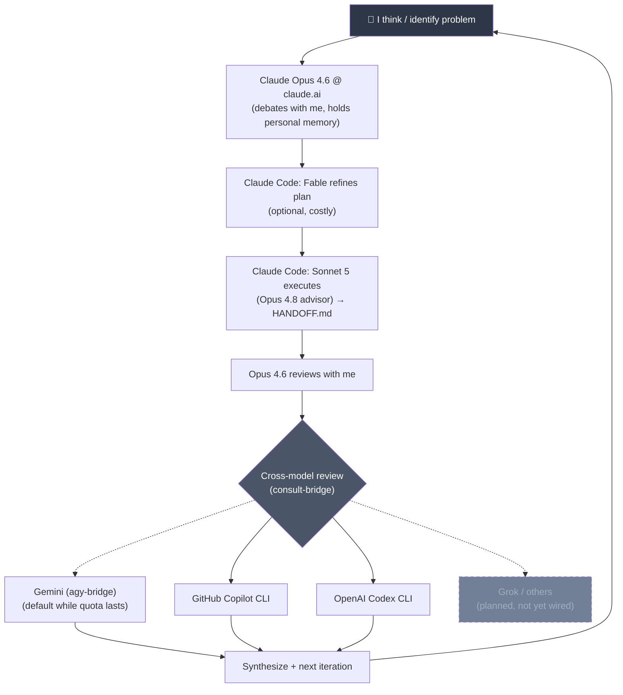

[English](README.md) · **繁體中文**

# claude-bridges

讓 Claude Code 能夠委派任務給其他程式設計 CLI 的 MCP 伺服器 —— 跨模型第二意見、結構化審查，以及多引擎諮詢小組。

大多數人用 AI 來做自動補全或向單一模型問單一問題。我則將多個模型作為具備制衡機制的結構化思考系統：辯論、執行、審查、交叉檢查、迭代。

## 思考循環



這不是「隨便問問 ChatGPT」。每個模型都有其角色、沙盒與審查關卡。沒有任何單一模型的輸出會在未經檢查的情況下直接交付。

## 實際接通的引擎

`consult` 工具目前會扇出至**五個引擎**：

| Engine | Wraps | Tier |
|---|---|---|
| `copilot` | GitHub Copilot CLI (`copilot -p`) | Free (GitHub) |
| `codex` | OpenAI Codex CLI (`codex exec`) | Free (ChatGPT) |
| `agy` | Antigravity / Gemini CLI | Google AI Plus（配額少）；**2026-10-27 起列入預設順序，直到剩餘配額用完為止** |
| `deepseek` | 以 `deeperseeker` proxy 代理 DeepSeek 網頁帳號（HTTP，非 CLI） | Free（拋棄式帳號） |
| `nim` | NVIDIA NIM 託管 API（HTTP，非 CLI） | Free（試用方案） |
| `openrouter` | OpenRouter 免費模型（HTTP，非 CLI） | Free（有速率限制）；列入預設順序（在 `nim` 之後），並帶有 5 個模型的備援鏈 |
| `dsapi` | DeepSeek 官方 API，僅限 flash 模型（HTTP，非 CLI） | 按量計費（便宜）；**選用（不在預設順序中）**，但同時是 `deepseek` 的自動備援 |

`agy` 原本採選用制（Google AI Plus 配額很少）；2026-10-27 起列入預設順序，配額用完即移除（之前以 `--order copilot,codex,deepseek,agy`
或 MCP 的 `order` 引數加入，建議每次審查只呼叫一次。

`deepseek` 已列入預設的 `CONSULT_ORDER`（排在最後，因此在 `first` 模式下僅作為備援）。它需要 `deeperseeker` proxy
在 `127.0.0.1:4000` 運作；若 proxy 未啟動或沒有金鑰，會自動備援到官方 API（`dsapi`，僅限 flash，標示 `deepseek->dsapi`，見下），若也沒有金鑰則軟性失敗，其他引擎仍會照常回答。
`nim` 也已列入預設順序（在 `deepseek` 之後，預設為 `copilot,codex,deepseek,agy,nim,openrouter`，`qwen` 可用時再加在最後），並帶有 5 個模型的備援鏈（`nvidia/nemotron-3-ultra-550b-a55b` -> `minimaxai/minimax-m3.1-flash` -> `nvidia/nemotron-3.5-super-vl-120b-a12b` -> `z-ai/glm-5.3-flash` -> `openai/gpt-oss-20b`，可用 `NIM_CHAIN` 覆寫；每步最多 120 秒，整條鏈受 `NIM_TIMEOUT` 限制，上限 600 秒）；明確寫 `nim:<其他模型>` 時只跑該模型、不走備援鏈。`openrouter` 自 2026-10-27 起同樣列入預設順序（在 `qwen` 之前），預設模型 `poolside/laguna-s-2.1:free` 與 `nim` 不同家族（兩條備援鏈的模型家族完全不重疊，由測試保證），兩者算作獨立的聲音；要排除它請明確指定 `--order`（例如 `--order copilot,codex,deepseek`）。`dsapi` 也是選用制（`--order copilot,codex,deepseek,dsapi`），且 `deepseek` 會自動備援到它（見下）。
與其他 CLI 引擎不同，`deepseek`、`nim`、`openrouter` 與 `dsapi` 沒有 cwd、shell 或檔案存取權限 ——
只看得到 prompt 文字本身，因此送給它們的 prompt 必須自帶完整脈絡。

### `openrouter`（OpenRouter 免費模型）

金鑰只需設定一次：放進 `~/.openrouter-key`（請限制權限：macOS/Linux 使用 `chmod 600`；Windows 使用
`icacls <file> /inheritance:r /grant:r "%USERNAME%:(R,W)"`）或匯出 `OPENROUTER_API_KEY`。環境變數優先。
沒有金鑰時，該引擎會回報 `[failed] no key`，其他引擎仍會照常回答。

請求送往 `https://openrouter.ai/api/v1/chat/completions`（`max_tokens` 1500）。
免費模型有速率限制，因此裸 `openrouter`（以及由 `--openrouter-model` / `OPENROUTER_MODEL` 指定的模型，或 `openrouter:<該預設模型>`）會依備援鏈往下試，
由指定的模型開始（最多 5 次；可用 `OPENROUTER_CHAIN=a/x:free,b/y:free` 覆寫）：
`poolside/laguna-s-2.1:free` -> `cohere/north-mini-code:free` -> `recursive/flint-v1.0:free` -> `dots-studio/dots-3-note-preview:free` -> `liquid/lfm-2.5-2.6b:free`。
遇到 404、410、429、5xx（含 HTTP 200 內夾帶的同類錯誤）、400「not a valid model ID」（模型已下架）、逾時、網路錯誤、空回覆或只含推理過程的回覆時換下一個；
其他錯誤（401 金鑰無效、402 無額度、其他 400）會立即結束備援鏈。開頭的 `<think>...</think>` 區塊會被移除。
結果會標示為實際回答的模型（`openrouter:<model>`）；若全部失敗，失敗訊息會列出各模型與原因（429 顯示為 `rate-limited`）。
順序中**明確**寫 `openrouter:<其他模型>` 時只跑該模型，使用整段逾時、不走備援鏈。
時間預算：每步最多 60 秒（`OPENROUTER_ATTEMPT_TIMEOUT_SEC`），整條鏈受 `OPENROUTER_TIMEOUT` 限制（預設 300 秒 = 5 x 60，上限 600 秒）；剩餘不足 15 秒的後續步驟會被略過。
2026-10-27 實測，這些免費模型回答一個小型 code review 提示約 2-21 秒。
此鏈與 `nim` 鏈沒有任何共同的模型家族（由測試保證）。刻意排除：`thinkingmachines/inkling[-small]:free`（403，僅限 agentic harness）、
`google/gemma-4-*:free` 與 `xingchen-agi/xing4.0-29b-a4b:free`（探測時每次都被上游 429）、`nvidia/nemotron-*:free`（與 `nim` 鏈同家族）。
模型優先順序：順序中的 `openrouter:<model>`，其次 `--openrouter-model`，再其次 `OPENROUTER_MODEL`，最後是內建預設值。
與 `nim`、`deepseek` 一樣沒有檔案存取權限：prompt 必須自帶完整脈絡。

### `dsapi`（DeepSeek 官方 API，僅限 flash）

金鑰只需設定一次：放進 `~/.deepseek-api-key`（請限制權限：macOS/Linux 使用 `chmod 600`；Windows 使用
`icacls <file> /inheritance:r /grant:r "%USERNAME%:(R,W)"`）或匯出 `DEEPSEEK_API_KEY`。環境變數優先；
檔案內容可含其他文字，取第一個 `sk-...` 字串。沒有金鑰時回報 `[failed] no key`，其他引擎仍會照常回答。

**OpenRouter 額度優先（2026-10-28）。** 有 OpenRouter 金鑰時（`OPENROUTER_API_KEY` 或 `~/.openrouter-key`），`dsapi`
先呼叫 OpenRouter 上的 `deepseek/deepseek-v4.1-flash`（模型在程式中固定，請求帶 `provider.data_collection: "deny"`），
之後才用官方 API。OpenRouter 回 401/402/403（金鑰錯誤、額度用完）時，本程序其餘時間都改走官方 API；429/5xx/網路錯誤只
讓該次請求回退。`DS_UPSTREAM=deepseek` 強制走官方 API。規則與 DS 工作者的金鑰代理（`~/.claude/bin/ds-keyproxy.py`）相同。
由 OpenRouter 回答的結果帶 `upstream: "openrouter"`。共用的 `:free` 額度池（每帳號每日 1000 次，面板與 agent 流程共用）有保留量：
設定 `OR_FREE_RESERVE=<n>` 後，`openrouter` 引擎在 `GET /api/v1/key` 回報剩餘 `<= n` 次時略過 `:free` 模型（每分鐘最多查一次；
面板預設 0＝不查詢，429 時換下一個；agent 流程 50，託管測試 200）。

請求送往 `https://api.deepseek.com/chat/completions`（OpenAI 相容；`max_tokens` 1500，逾時 90 秒，關閉 thinking 模式）。
遇到 HTTP 429（遵循 `Retry-After`，有上限）、5xx、逾時或網路錯誤時重試一次；400/401/402/403 不重試。
開頭的 `<think>...</think>` 區塊會被移除。預設模型為 `deepseek-flash`（DeepSeek 一直讓它指向目前的 Flash 模型，
已用 `GET /models` 確認；舊名 `deepseek-v4-flash` 仍可使用）。

**僅限 flash。** 此引擎用於便宜的第二意見，因此拒絕任何非 Flash 模型。由於 DeepSeek 會不斷更改模型 ID，規則是樣式而非固定清單：
ID 含有 `flash` 字樣（`deepseek-flash`、`deepseek-v6-flash`、`v4.1flash`，大小寫不拘）且**不含** `pro` 或 `reasoner` 才會被接受
（因此 `deepseek-v4-pro`、`deepseek-reasoner`、`deepseek-chat`、`deepseek-flash-pro` 都會被拒絕）。被拒絕的模型
（來自 `dsapi:<model>`、`--dsapi-model` 或 `DSAPI_MODEL`）會以 `dsapi is limited to flash` 失敗，且不會送出任何請求。
模型優先順序：順序中的 `dsapi:<model>`，其次 `--dsapi-model`，再其次 `DSAPI_MODEL`，最後是內建預設值。

**`deepseek` 的自動備援。** 當 `deeperseeker` proxy 無法連線（例如連線被拒）、沒有金鑰或回應 HTTP 5xx 時，`deepseek` 引擎會改用 `dsapi`
重送 prompt，結果標示為 `deepseek->dsapi`，讓預設面板（`copilot,codex,deepseek`）在 proxy 停擺時仍保有 DeepSeek 的聲音。
proxy 正常回答時完全不變；proxy 回 4xx 或指定了 `deepseek:<model>` 時不會觸發備援。備援也失敗時，錯誤訊息會同時列出兩者的原因。
若在同一順序中同時列出 `deepseek` 與 `dsapi`，proxy 停擺時會呼叫兩次。

**用量警示。** 每次請求與回應中的 token 用量（prompt + completion）會依本地日期記錄在
`~/.dsapi-usage.json`（`{"day","requests","promptTokens","completionTokens"}`）。每日超過 **300 次請求**時，
可能呼叫 dsapi 的執行會在頁尾印出一行警告（`[consult] dsapi: N requests today ...`；CLI 為 stderr，MCP 工具則附加在結果後）。
300 僅是軟性警示：不會阻擋任何請求，因為 Flash 很便宜。

### `nim`（NVIDIA NIM）

金鑰只需設定一次：放進 `~/.nvidia-nim-key`（請限制權限：macOS/Linux 使用 `chmod 600`；
Windows 則依賴使用者設定檔的 ACL），或設定環境變數 `NIM_API_KEY`（環境變數優先）。

順序中的項目可寫成 `engine` 或 `engine:model`（只以第一個 `:` 切分，因此含 `/` 的模型 ID 可正常使用）。
`copilot`、`codex`、`nim`、`deepseek`、`openrouter`、`dsapi` 支援指定模型；`agy:x` 與未知引擎會被忽略。
（`copilot:<model>` 在語法上可接受，但僅支援自動選模型的 Copilot 方案會拒絕 `--model`；此時引擎會改用自動模式重試一次，
並將結果標示為 `copilot (auto; <model> unavailable on this plan)`。）`nim:<預設模型>` 與單獨的 `nim` 視為同一項目，會去除重複。
如此一次諮詢即可同時詢問多個 NIM 模型，結果會標示為 `nim:<model>`：

```bash
node consult-cli.js --order nim:moonshotai/kimi-k3,nim:z-ai/glm-5.3,codex "prompt"
```

`nim` 的模型優先順序：順序中的 `engine:model`，其次 `--nim-model`，再其次 `NIM_MODEL`，最後是內建預設值。
若模型只回傳推理過程而沒有最終答案，該段會以 `[reasoning only: ...]` 開頭；
回答被截斷時會附上 `[truncated: hit max_tokens]`（可調高 `NIM_MAX_TOKENS`），被截斷的回答仍視為有效回答。
只有「僅含推理過程」的回覆在 `--mode all` 中仍會顯示，但在 `--mode first` 中視為失敗，會改由下一個引擎接手
（若所有引擎都只回傳推理過程，則以第一個此類回覆作為最後手段顯示，並附上說明）。只有回覆最開頭的 `<think>` 區塊會被當作推理過程；回答中途引用的標籤不會被處理。

免費試用金鑰的上限約為每分鐘 40 個請求；NVIDIA 並未公開限制，且可能隨時調整。
使用須遵守 NVIDIA API Trial Terms（僅限評估、非正式環境用途）。額度以金鑰為單位，
因此任何使用同一把金鑰的其他應用程式都會共用這份額度。收到 HTTP 429 時，consult 會等待
（依 `Retry-After`，否則 5 秒，最長 15 秒）並重試一次，仍失敗則回報該引擎受到速率限制。

免費方案的延遲會因模型而有很大差異：在煙霧測試中，預設的 `nvidia/nemotron-3-ultra-550b-a55b` 約 20 秒就回答了一個小型審查 prompt，
而其他部分模型要 150 秒，甚至在 180 秒時逾時。此外，NIM 的 `/v1/models` 會列出這把金鑰無法呼叫的模型
（HTTP 404，`Function ... Not found for account`），因此請先試用再依賴。`nim` 有自己的逾時設定，與 `CONSULT_TIMEOUT` 無關：`NIM_TIMEOUT` 秒（預設 600），上限固定為 600
（10 分鐘；設得更大會被限制為 600，無效的值則回到 600）。各引擎是平行執行的，因此慢速模型只會拖慢它自己的區段。
429 重試與此共用同一個期限。

`nim` 請求採用串流（SSE）：consult 會累積增量內容（答案與推理），並組成與一般回覆相同的結果。約有兩個限制落在 300 秒：模型在該時間內仍未開始回答時，NVIDIA 的閘道會回傳真正的
HTTP 504（顯示為 `NVIDIA gateway timeout ...`，不重試）；而 Node 的 `fetch` 在 300 秒內沒有收到回應標頭，
或串流途中 300 秒沒有任何資料區塊（指區塊之間的閒置時間，而非總時間）時也會放棄（顯示為
`no response headers within ~300 s` / `stream stalled, no data for ~300 s`，而不是 `fetch failed`）。簡言之：
第一個 token 必須在約 300 秒內出現，之後整個串流可以持續到 `NIM_TIMEOUT`（最高 600 秒）。若不串流，整個答案都得在 300 秒內完成，
因此超過 300 的 `NIM_TIMEOUT` 只對已經開始回答的模型有幫助；卡在免費方案佇列中的模型仍會在約 300 秒時失敗。若期限在串流途中到達，
會回傳目前已收到的文字並附上 `[truncated: timed out after Ns]`（只有推理內容時以僅推理方式顯示；什麼都沒收到則為一般逾時）。
非 `text/event-stream` 的回覆會當作一般完成結果解析。`deepseek` 不使用串流。HTTP 504 代表閘道等不到第一個 token 而放棄；HTTP 502 則顯示為一般的
`NVIDIA gateway error (HTTP 502)` 並附上回應內容。兩者都不會重試。

若 consult 是以 MCP `consult-bridge` 執行，其註冊需設定 `"timeout": 660000` 或更大，`nim` 才能用滿 10 分鐘（下方註冊範例已使用此值）。
在 `--mode first` 中各引擎是依序執行，卡住的 `nim` 最多會拖住整條備援鏈 600 秒，`nim` 加上備援引擎可能超過 660 秒：
請把 `nim` 放在順序的最後，或改用 `--mode all`（平行執行）。

#### 每兩週一次的新模型檢查

NIM 經常新增模型，因此只要存在 NIM 金鑰，使用到 `nim` 的 consult 執行（順序中含 `nim` 或 `nim:<model>`）
最多每 14 天（`NIM_MODELS_CHECK_DAYS`）會在背景處理程序中檢查一次 `/v1/models`。成本是每 14 天一次 `/v1/models` 請求，
不會呼叫任何模型。第一次檢查只會記錄基準；之後的檢查會把清單與先前看過的 ID 比對（嵌入、安全防護、語音等非對話模型會被忽略）。
結果會以一行通知呈現，直到下一次檢查為止（`consult-cli` 輸出於 stderr；`consult-bridge` 附加於工具結果），例如
`[consult] NIM: 2 new models since 2026-10-10: a/b, c/d -> worth a look in a separate session; try --order nim:<id>`
（最多列出 6 個 ID，其餘以 `(+K more)` 表示）。出現在清單中並不代表你的金鑰能呼叫該模型，或在免費方案上夠快，請視為參考提示。

- 結果快取：`~/.cache/claude-bridges/nim-models.json`（或 `$CLAUDE_BRIDGES_CACHE_DIR/nim-models.json`），格式為
  `{checkedAt, attemptAt, baselineAt, seen, new: [ids], error}`；其中絕不會包含金鑰。`checkedAt` 是最近一次成功取得清單的時間
  （失敗時不變），`attemptAt` 是最近一次嘗試的時間。當 `checkedAt` 已超過檢查間隔且 `attemptAt` 已超過一天時才會再次檢查，
  因此清單服務失敗時會每天重試，而不是等上兩週。
- 通知節流：通知最多顯示 3 次，之後靜默一天（出現新的檢查結果則重新計算）。狀態存放在快取旁的 `nim-notice.json`，
  格式為 `{key, count, windowStart, cooldownUntil}`，其中 `key` = `<checkedAt>:<以逗號串接的新 ID>`，且只有在通知實際
  印出或附加時才會（以原子方式）寫入。所有使用端共用同一份狀態，包括遵循相同規則的外部 hook：`key` 不同就從零開始；
  `now < cooldownUntil` 時保持靜默；若 `now - windowStart >= 24 小時`（或 `now < windowStart`，即時鐘被往回調）則重設 `count` 並令 `windowStart = now`；
  接著 `count += 1`，當 `count >= 3` 時設定 `cooldownUntil = now + 24 小時`。檔案不存在或損毀視為「顯示」；
  節流檔案的任何錯誤都不會中斷 consult 執行。
- 以下兩個旗標不需要在順序中包含 `nim`。
- `node consult-cli.js --check-nim-models` 立即強制檢查並印出通知（或 `no new models`）。
- `node consult-cli.js --refresh-nim-models` 在處理程序內執行受節流限制的檢查，不輸出任何內容，只寫入快取
  （背景的分離式更新與外部 hook 都是呼叫此旗標）。

Grok 與其他模型已列入構想循環中，但尚未建立 bridge。本系統設計具備擴充引擎的能力 —— 每個引擎在 `lib/engines.js` 中僅需約 30 行程式碼。

## 架構

```
claude-bridges/
  package.json            shared deps (@modelcontextprotocol/sdk, zod)
  node_modules/           one install serves all bridges
  lib/
    common.js             shared MCP boilerplate, CLI runner, cross-platform exe resolution
    engines.js            engine runners shared by consult-bridge and consult-cli
    args.js               consult-cli argument parsing
    updates.js            throttled update check + --update
  consult-cli.js          same panel as a plain command (no MCP schema cost)
  test/                   node --test suite (npm test)
  copilot-bridge/
    index.js              standalone MCP server → copilot_exec tool
  codex-bridge/
    index.js              standalone MCP server → codex_exec tool
  consult-bridge/
    index.js              aggregator MCP server → consult tool
  agy-bridge-vendored/    vendored copy of the agy-bridge (Gemini)
```

三個 MCP 伺服器；實際使用的是 `consult-bridge`，另外兩個為**舊版（legacy）**（仍可運作，但預設不註冊）：

| Bridge | 工具 | 預設策略 |
|---|---|---|
| `copilot-bridge` | `copilot_exec` | 限制性：禁止寫入檔案，僅自動核准讀取/搜尋/git-gh shell |
| `codex-bridge` | `codex_exec` | 沙盒化 `read-only` |
| `consult-bridge` | `consult` | 聚合器：平行執行所有引擎（`mode: all`）或循序後備切換（`mode: first`） |

三者皆透過 `lib/common.js` 解析 CLI 執行檔（PATH，加上 macOS/Linux 的 `/opt/homebrew/bin`、`/usr/local/bin`、`~/.local/bin`；Windows AppData 後備路徑僅在 Windows 使用）。`consult-bridge` 與 `consult-cli` 在 `lib/engines.js` 自行建構引數。缺少某個 CLI 只會讓該引擎失敗，例如 `copilot: not installed (looked in ...)`。

## 工具

### `consult`（核心亮點）

諮詢外部模型小組。具備兩種模式：

- **`all`**（預設）—— 平行執行每個引擎，回傳所有成功的回答並標註所屬引擎。適用於需要觀點多樣性的跨模型第二意見。
- **`first`** —— 循序後備鏈，以第一個成功的回應為主。成本較低，適用於例行問題或額度吃緊時。

```
consult({
  prompt: "Review this auth middleware for timing attacks",
  mode: "all",           // "all" | "first"
  order: ["copilot", "codex", "deepseek"]  // engine set/chain order
})
```

引擎順序可透過 `order` 引數或 `CONSULT_ORDER` 環境變數設定（預設為 `copilot,codex,deepseek,agy,nim,openrouter`；`order` 與 `CONSULT_ORDER` 的項目都可寫成 `engine:model`；MCP 的 `order` 是字串陣列，無效的項目會被忽略並回報，若沒有任何有效項目則回傳錯誤）。失敗的引擎（配額耗盡、驗證失敗、逾時、輸出為空、非零結束代碼）會自動容錯移轉至下一個引擎；相關歷程紀錄會附加於結果之後。

### `copilot_exec`

委派給 GitHub Copilot CLI，採無周邊（headless）且非互動式模式。預設為唯讀 —— 可以讀取與搜尋 `cwd` 下的檔案，但無法修改檔案。

### `codex_exec`

透過 `codex exec` 委派給 OpenAI Codex CLI。預設為沙盒化唯讀。只有當你確實打算讓 Codex 編輯檔案時，才傳入 `sandbox: "workspace-write"`。

## 命令列與更新

```bash
node consult-cli.js --mode all --order copilot,codex "prompt"
node consult-cli.js --copilot-model M --copilot-effort high --codex-model M --codex-effort low "prompt"
node consult-cli.js --nim-model M "prompt"       # 指定 nim 引擎的模型（順序中的 nim:M 優先於此旗標）
node consult-cli.js --openrouter-model M "prompt" # 指定 openrouter 引擎的模型（順序中的 openrouter:M 優先於此旗標）
node consult-cli.js --dsapi-model M "prompt"    # 指定 dsapi 引擎的模型（僅限 flash ID；順序中的 dsapi:M 優先於此旗標）
node consult-cli.js --check-nim-models         # 立即強制執行 NIM 新模型檢查
node consult-cli.js --prompt-file review.txt   # 從檔案讀取 prompt（"-" 代表標準輸入），不可與 prompt 文字並用。適用於 diff 等長 prompt，避免超出作業系統的命令列長度上限
node consult-cli.js --out-dir /tmp/c "prompt"   # 每個引擎完成時即寫入 <dir>/<engine>.md，全部完成後寫入 <dir>/_done（檔名中的 : 與 / 等不安全字元會改為 _）
node consult-cli.js --debate spec.json --out-dir /tmp/d   # 結構化辯論（見下方「辯論模式」）；印出 <dir>/digest.md 路徑與 TALLY 行
node consult-cli.js --check-updates   # 立即檢查、印出結果後結束
node consult-cli.js --update          # brew upgrade --cask <過期的 CLI>；git pull --ff-only（工作樹有未提交變更時拒絕）
```

`--mode all` 時，`consult-cli` 會在每個引擎完成的當下依完成順序印出該引擎完整的 `## <engine>` 區段（回答或 `[failed] 原因`），最後才印 `[consult] mode: all | ...` 摘要行。各引擎逾時彼此獨立，慢的引擎不會拖延其他引擎。`consult-bridge` 仍回傳單一彙整結果，但使用相同的執行器（`lib/panel.js`）。

### 辯論模式

`consult-cli --debate <spec.json> --out-dir <dir>` 以固定流程進行最多三輪辯論，並讓呼叫端的上下文保持精簡：完整回答寫入檔案，呼叫端只需讀 `digest.md`（5 個引擎約 1.5k token）。Spec：

```json
{ "question": "A or B?", "context": "選用的內嵌文字", "context_files": ["notes.md"],
  "word_cap": 250, "rebuttal_cap": 150, "cross_cap": 100, "rounds": 3,
  "stances": [ { "engine": "copilot", "stance": "argue for A" },
               { "engine": "deepseek", "stance": "argue for B", "fallback": ["openrouter", "nim"] } ] }
```

- Prompt 一律自給自足（內嵌 `context` 加上 `context_files`，每檔 20 KB、總計 60 KB，截斷處會標記），因為 deepseek、nim、openrouter、qwen 沒有檔案存取權限。每則回覆必須以 `CLAIMS`（最多 3 點）/ `CONCEDES` / `BOTTOM LINE` 區塊結尾。
- 第 1 輪：所有立場並行執行（`<dir>/r1/<engine>.md`，另有 `.prompt.md`）。第 2 輪（`rounds: 2`）：第 1 輪有回答的引擎各自收到自己的立場，加上其他引擎第 1 輪的結尾區塊（不含全文），並以 `FINAL PICK: <option> - <原因>` 結尾（`<dir>/r2/`）。第 1 輪同樣以開場 `FINAL PICK` 結尾。
- 防從眾（第 2、3 輪）：對手以 `Debater N` 呈現（不含引擎名稱、票數或多數暗示），prompt 明說「多數同意不是證據」。每則回覆加上 `CHANGED BECAUSE:`（哪位 Debater 的哪項主張改變了立場，或 `unchanged`）與 `WOULD CHANGE MY MIND IF:`。
- 第 3 輪（`rounds: 3`，字數上限 `cross_cap` 預設 100）僅在第 2 輪 FINAL PICK 仍不一致時執行；每位有 pick 的辯手只會看到「pick 與自己不同」的辯手的主張並只回應這些（`<dir>/r3/`）；否則略過，digest 會說明原因。digest 另列每個引擎的 pick 軌跡，例如 `nim: D -> A -> A (R2 changed: Debater 2 claim 1)`；沒說明理由就改變 pick 會標記 `NO REASON GIVEN`，TALLY 採用各引擎最後一次的 pick。借用的做法：獨立第一輪與匿名化同儕（Du et al. 2023；arXiv 2510.07517）、批判而非求共識的提示（Free-MAD，arXiv 2509.11035）；也有論文指出單純多數決即可達到辯論的多數增益，因此 digest 保留原始 pick 與軌跡，而非由裁判下結論。
- 缺少結尾區塊標為 `TAIL_MISSING`（其他引擎會看到該引擎最後約 120 字並加註），失敗的引擎標為 `ENGINE_FAILED: <原因>`；單一引擎失敗不會中止辯論。立場的 `fallback` 清單只重試一次，使用第一個尚未被使用的引擎，並標示為 `<fallback> (for <engine>)`。
- `digest.md` 逐字收錄各引擎的結尾區塊與 FINAL PICK、檔案路徑與 `TALLY:` 行；`<dir>/_done` 最後寫入。Spec 錯誤時結束碼為 2。

`consult-cli` 與 `consult-bridge` 啟動時會檢查（每 24 小時至多一次，快取於 `~/.cache/claude-bridges/updates.json`）引擎 CLI（brew 安裝的 cask 用 `brew outdated --cask --greedy`，否則用 `copilot version`）與本儲存庫（`git fetch` 後比對落後 commit 數）是否過期。頁尾取自上一次檢查的快取結果；快取過期時由分離的背景行程（CLI）或並行（MCP 伺服器）更新，因此不會拖慢或使諮詢失敗；僅在有過期項目時印出一行頁尾（MCP 伺服器則放在工具結果內）。未加 `--update` 不會安裝任何東西。

## 安裝

```powershell
cd ~/claude-bridges
npm install
```

在根目錄執行單次 `npm install` 即可供應所有伺服器 —— Node 會從各個 `index.js` 向上查找來解析 `node_modules`。

## 註冊（使用者範圍）

```powershell
claude mcp add-json copilot-bridge  '{"command":"node","args":["C:/Users/YOU/claude-bridges/copilot-bridge/index.js"],"timeout":600000}' -s user
claude mcp add-json codex-bridge    '{"command":"node","args":["C:/Users/YOU/claude-bridges/codex-bridge/index.js"],"timeout":600000}' -s user
claude mcp add-json consult-bridge  '{"command":"node","args":["C:/Users/YOU/claude-bridges/consult-bridge/index.js"],"timeout":660000}' -s user
```

請將 `C:/Users/YOU` 替換為你的實際家目錄。這三個 CLI 都必須先完成驗證：

```bash
copilot login    # GitHub Copilot CLI
codex login      # OpenAI Codex CLI
# agy: see agy-bridge docs for Gemini auth
```

## 設定（環境變數）

### 通用設定

| 變數 | 預設值 | 說明 |
|---|---|---|
| `*_TIMEOUT` | `600` | 各引擎逾時時間（秒） |
| `*_MAX_OUTPUT_CHARS` | `50000` | 輸出截斷上限字數 |
| `*_MODEL` | （引擎預設） | 覆寫所使用的模型 |
| `*_BIN` | （自動解析） | 覆寫 CLI 執行檔路徑 |

consult 小組的覆寫變數：`COPILOT_BRIDGE_BIN`、`CODEX_BRIDGE_BIN`、`AGY_PATH`、`GROK_PATH`。

### copilot-bridge

| 變數 | 預設值 | 說明 |
|---|---|---|
| `COPILOT_BRIDGE_PERM_ARGS` | （限制性預設值） | 整批替換權限旗標。JSON 陣列或以空白分隔的字串。在 Copilot 中拒絕規則（Deny）永遠優先於允許規則（Allow）。 |

### codex-bridge

| 變數 | 預設值 | 說明 |
|---|---|---|
| `CODEX_BRIDGE_SANDBOX` | `read-only` | `read-only`、`workspace-write` 或 `danger-full-access`。亦可在每次呼叫時透過 `sandbox` 引數覆寫。 |

### consult-bridge

| 變數 | 預設值 | 說明 |
|---|---|---|
| `CONSULT_TIMEOUT` | `300` | 各引擎逾時時間（秒）（`nim` 不適用，請見 `NIM_TIMEOUT`） |
| `CONSULT_MAX_OUTPUT_CHARS` | `50000` | 總輸出截斷上限字數 |
| `CONSULT_PER_ENGINE_CHARS` | `20000` | `all` 模式下各引擎截斷字數 |
| `CONSULT_ORDER` | `copilot,codex,deepseek,agy,nim,openrouter` | 預設引擎順序 |
| `CONSULT_MODE` | `all` | 預設模式（`all` 或 `first`） |
| `COPILOT_MODEL` | （未設 = auto） | 僅在設定時以 `--model` 傳入。若 Copilot 拒絕（如 Student 方案僅支援 auto），會改用 auto 重試一次並標示為 `copilot (auto; <model> unavailable on this plan)` |
| `COPILOT_EFFORT` | （未設） | `--reasoning-effort none\|minimal\|low\|medium\|high\|xhigh\|max` |
| `CODEX_MODEL` | （未設） | 僅在設定時以 `-m` 傳入 |
| `CODEX_EFFORT` | （未設） | 以 `-c model_reasoning_effort="..."` 傳入 |
| `CLAUDE_BRIDGES_CACHE_DIR` | `~/.cache/claude-bridges` | 更新檢查的快取位置 |
| `DEEPSEEKER_BASE` | `http://127.0.0.1:4000` | deeperseeker proxy 的 base URL |
| `DEEPSEEKER_MODEL` | `v4.1flash` | 傳給 proxy 的 model id |
| `DEEPSEEKER_API_KEY` | （從 proxy `.env` 讀取） | Proxy API key，未設時回退至 `DEEPSEEKER_ENV_PATH` |
| `DEEPSEEKER_ENV_PATH` | `~/Claude/deeperseeker/.env` | 環境變數未設時，從何處讀取金鑰 |
| `NIM_API_KEY` | （未設定） | NVIDIA NIM 金鑰，優先於金鑰檔案 |
| `NIM_KEY_PATH` | `~/.nvidia-nim-key` | 未設 `NIM_API_KEY` 時讀取的金鑰檔案 |
| `NIM_MODEL` | `nvidia/nemotron-3-ultra-550b-a55b` | 順序項目與 `--nim-model` 都未指定時的預設 NIM 模型（備援鏈第一步） |
| `NIM_CHAIN` | `nvidia/nemotron-3-ultra-550b-a55b,minimaxai/minimax-m3.1-flash,nvidia/nemotron-3.5-super-vl-120b-a12b,z-ai/glm-5.3-flash,openai/gpt-oss-20b` | 備援鏈在指定模型之後依序嘗試的模型（逗號分隔；最多 5 次，每步最多 120 秒，整條鏈受 `NIM_TIMEOUT` 限制） |
| `NIM_BASE` | `https://integrate.api.nvidia.com` | NIM API 基底 URL |
| `OPENROUTER_API_KEY` | （未設定） | OpenRouter 金鑰，優先於金鑰檔案 |
| `OPENROUTER_KEY_PATH` | `~/.openrouter-key` | 未設 `OPENROUTER_API_KEY` 時讀取的金鑰檔案（取第一個 `sk-or-...` 字串） |
| `OPENROUTER_MODEL` | `poolside/laguna-s-2.1:free` | 順序項目與 `--openrouter-model` 都未指定時的預設 OpenRouter 模型（備援鏈第一步） |
| `OPENROUTER_CHAIN` | `poolside/laguna-s-2.1:free,cohere/north-mini-code:free,recursive/flint-v1.0:free,dots-studio/dots-3-note-preview:free,liquid/lfm-2.5-2.6b:free` | 備援鏈在指定模型之後依序嘗試的模型（逗號分隔；最多 5 次，每步最多 60 秒，整條鏈受 `OPENROUTER_TIMEOUT` 限制） |
| `OPENROUTER_TIMEOUT` | `300` | openrouter 整條備援鏈的逾時秒數（正數）；上限 600，忽略 `CONSULT_TIMEOUT` |
| `DEEPSEEK_API_KEY` | （未設定） | `dsapi` 使用的 DeepSeek 官方 API 金鑰，優先於金鑰檔案 |
| `DSAPI_KEY_PATH` | `~/.deepseek-api-key` | 未設 `DEEPSEEK_API_KEY` 時讀取的金鑰檔案（取第一個 `sk-...` 字串） |
| `DSAPI_MODEL` | `deepseek-flash` | 順序項目與 `--dsapi-model` 都未指定時的預設 `dsapi` 模型；必須是 flash ID（不含 `pro`/`reasoner`） |
| `NIM_MAX_TOKENS` | `8192` | 傳給 NIM 的 `max_tokens` |
| `NIM_TIMEOUT` | `600` | NIM 逾時時間（正數，單位為秒），上限 600，不受 `CONSULT_TIMEOUT` 影響。MCP 註冊需設定 `"timeout": 660000` 或更大才能用滿 |
| `NIM_MODELS_CHECK_DAYS` | `14` | NIM 新模型檢查的間隔（正數，單位為天） |

## 為什麼需要這個專案

我從國中就開始動手做東西 —— 最早是 Arduino 草稿碼，現在是 PCB 與交易系統。AI 是我的工具箱與學習循環的一部分：我用 Opus 4.6 思考（天生的規劃者/辯論者），用 Sonnet 5 + Opus 4.8 執行（嚴格的提示詞遵循者，專為交付成果而生），並在任何內容落地前，透過 Gemini、Copilot 與 Codex 進行交叉檢查。

每個模型都有與其訓練方式契合的任務：

- **思考** —— claude.ai 上的 Opus 4.6 保留我的個人記憶、與我辯論各種方案，並在我投入之前對計畫進行壓力測試。它的訓練偏向推理與細微差異的掌握 —— 這正是規劃所需要的。
- **執行** —— Sonnet 5 撰寫程式碼；Opus 4.8 作為顧問進行審查。兩者都受過嚴格遵循提示詞與精確輸出的訓練 —— 它們負責交付成果，而不是空談哲學。
- **交叉檢查** —— `consult` 平行扇出給 Copilot、Codex 與 Gemini。不同的訓練資料、不同的盲點、獨立的評判。沒有任何單一模型能說了算。
- **迭代** —— 所有結果都會回饋給我。由我整合、定奪並開啟下一個循環。人類在每個關卡都保持在控制迴圈中（human-in-the-loop）。

除了模型選擇之外，每次委派都會附帶一個**角色提示詞（role prompt）** ——「身為資安稽核員…」、「身為前端工程師…」、「身為 Karpathy 風格的程式碼審查員…」—— 讓模型能從特定的專業框架回應，而不是當一個泛用的助手。我維護著一份完整的角色表（涵蓋工程、產品、內容與研究等 20 多個角色），將每個角色對應到合適的模型層級與工具。

這些 bridge 就是基礎管線設施，讓交叉檢查得以程式化自動進行 —— 而不需要在各個聊天視窗之間手動複製貼上。
