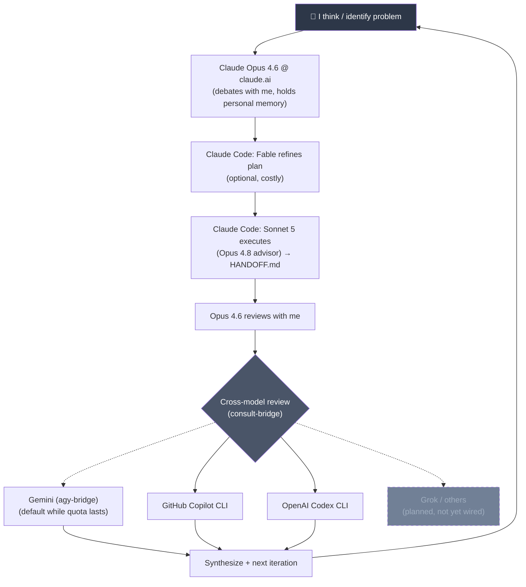

[English](README.md) · **繁體中文**

# claude-bridges

讓 Claude Code 能夠委派任務給其他程式設計 CLI 的 MCP 伺服器 —— 跨模型第二意見、結構化審查，以及多引擎諮詢小組。

大多數人用 AI 來做自動補全，或向單一模型問一個問題。我則把多個模型當成一套有制衡機制的結構化思考系統：辯論、執行、審查、交叉檢查、迭代。

## 一目了然

| | |
|---|---|
| 問題 | 一個模型只給一個答案，也只有一組盲點。 |
| 我做了什麼 | MCP 伺服器，讓 Claude Code 把同一個 prompt 送給其他程式設計 CLI 與託管 API —— 可平行跑（`mode: all`），也可當備援鏈依序跑（`mode: first`）。 |
| 結果 | 2026-10-27 實測，OpenRouter 免費模型回答一個小型 code review 提示約 2-21 秒。同一天用評測挑出 NIM 備援鏈：ultra 27-79 秒、minimax-m3.1-flash 93 秒、super-vl 57 秒，三者都找到故意埋的錯誤。 |
| 技術棧 | Node.js；`@modelcontextprotocol/sdk` 與 `zod`。 |
| 狀態 | 使用中。`agy` 自 2026-10-27 起列入預設順序，配額用完就移除。 |

## 運作方式



這跟「隨便問問 ChatGPT」是兩回事。每個模型都有自己的角色、沙盒與審查關卡。

小組成員就是 `CONSULT_ORDER` 裡的引擎（預設 `copilot,codex,deepseek,agy,nim,openrouter,opencode,azure,gemini`）。`mode: all`（預設）把同一個 prompt 平行送給全部引擎，每個成功的回答都會標上引擎名稱。`mode: first` 則是依序的備援鏈，第一個成功就停。某個引擎失敗會換下一個，過程會附在結果後面。

`deepseek`、`nim`、`openrouter` 與 `dsapi` 沒有 cwd、shell 或檔案存取權限 —— 它們只看得到 prompt 文字，所以 prompt 必須自帶完整脈絡。

完整引擎表、各條備援鏈與逾時設定在 [docs/engines.zh-TW.md](docs/engines.zh-TW.md)。

## 開發歷程

一個答案看不見自己的盲點。這個小組存在的目的，就是讓任何單一模型的輸出都不會沒檢查就交出去。

2026-10-27 的評測用一份故意埋了錯誤的 code review 提示來挑 NIM 備援鏈。ultra 以 27-79 秒回答、minimax-m3.1-flash 93 秒、super-vl 57 秒，三者都把那些錯誤找了出來。glm-5.3（396 秒）、glm-5.3-flash（319 秒）與 step-5-preview（228 秒）不是太慢就是太不穩，放不進前幾步；`openai/gpt-oss-20b` 以 5-10 秒回答，收在鏈尾。同一天，OpenRouter 免費模型回答一個小型 code review 提示約 2-21 秒。

會有這種落差，是因為免費方案本身不穩：模型會卡住、消失（HTTP 404，或終止支援後回 410），或只回推理過程；而且免費佇列是共用的，延遲每次差很多。

解法是讓每個免費引擎各走一條備援鏈，每一步有自己的逾時，而且裸 `nim` 或 `openrouter` 可以換到別的模型。有測試保證 OpenRouter 鏈與 NIM 鏈不共用任何模型家族，同一個聲音不會被算兩次。配額上限若有明講重置時間，就寫成一把鎖，之後的執行會跳過該引擎直到那時。

還沒做完的：Grok 與其他模型只出現在循環圖裡，還沒有 bridge；`agy` 的 Google AI Plus 配額用完後就會退出預設順序。

整體的分工寫在 [docs/why.zh-TW.md](docs/why.zh-TW.md)：Opus 4.6 負責計畫與記憶，Sonnet 5 寫程式、Opus 4.8 當顧問，`consult` 在上線前做交叉檢查。每次委派也會帶一個角色提示詞。

## 建置與執行

```bash
npm install
node consult-cli.js --mode all --order copilot,codex "prompt"
npm test
```

在根目錄跑一次 `npm install`，所有伺服器就都能用 —— Node 會從各個 `index.js` 往上層目錄找 `node_modules`。

- MCP 註冊、CLI 登入，以及 `nim` 需要的 `"timeout": 660000`：[docs/setup.zh-TW.md](docs/setup.zh-TW.md)。
- 所有旗標、第二輪、配額鎖與辯論模式：[docs/consult-cli.zh-TW.md](docs/consult-cli.zh-TW.md)。
- 環境變數與預設值：[docs/configuration.zh-TW.md](docs/configuration.zh-TW.md)。
- `consult-cli.js --json` 只印一個 `{ok,code,message,data}` 物件；格式見 [docs/cli-json.md](docs/cli-json.md)。

## 專案結構

```
claude-bridges/
  package.json            shared deps (@modelcontextprotocol/sdk, zod)
  node_modules/           one install serves all bridges
  lib/
    common.js             shared MCP boilerplate, CLI runner, cross-platform exe resolution
    engines.js            engine runners shared by consult-bridge and consult-cli
    args.js               consult-cli argument parsing
    updates.js            throttled update check + --update
  consult-cli.js          same panel as a plain command (no MCP schema cost)
  test/                   node --test suite (npm test)
  copilot-bridge/
    index.js              standalone MCP server → copilot_exec tool
  codex-bridge/
    index.js              standalone MCP server → codex_exec tool
  consult-bridge/
    index.js              aggregator MCP server → consult tool
  agy-bridge-vendored/    vendored copy of the agy-bridge (Gemini)
```

共有三個 MCP 伺服器。`consult-bridge` 是實際在用的；`copilot-bridge` 與 `codex-bridge` 為**舊版（legacy）**（仍可運作，預設不註冊）。工具名稱、預設策略與執行檔解析在 [docs/bridges.zh-TW.md](docs/bridges.zh-TW.md)。

## 限制與待辦

- Grok 與其他模型在構想循環中，但還沒有 bridge。
- `agy` 只在 Google AI Plus 配額還夠時列入預設順序（2026-10-27 起）。
- 供應商可能會記錄或使用 `opencode` 免費模型的內容：只送非機密的 prompt。
- NIM 免費試用須遵守 NVIDIA API Trial Terms（僅限評估、非正式環境用途）；額度以金鑰為單位，任何使用同一把金鑰的應用程式都共用。
- NIM 的 `/v1/models` 也會列出這把金鑰不能呼叫的模型；卡在免費佇列的模型仍會在約 300 秒時失敗。
- dsapi 每日 300 次請求的警告只是軟性提醒：不會擋任何請求。

## 授權

MIT 授權。請見 [LICENSE](LICENSE)。
